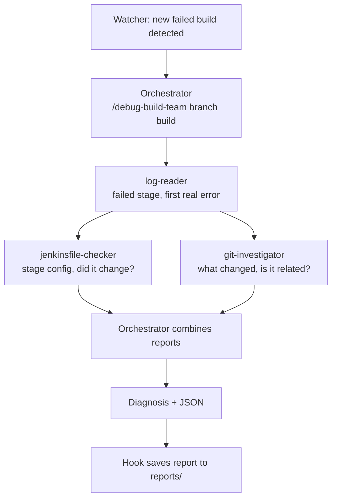

# Jenkins AI Debugger

An AI agent that diagnoses failed Jenkins pipeline builds: it reads the console log, inspects the Jenkinsfile and the git history, finds the root cause and recommends a fix. Built three ways (a Claude API script, a Claude Code agent, and a multi-agent team) and evaluated against a curated set of real failures.

> **Headline result:** giving the agent access to the repository and git history, not a bigger model, raised the rate of fully correct fixes from **2/5 to 5/5**. The most efficient setup diagnoses a failure for about **$0.09 in ~19 seconds**.

*Personal learning project, built on a local lab. Not affiliated with any employer, and no company systems or data were used.*

---

## Results

All versions were graded on the same 5 failure cases, with the same answer keys, the same LLM judge and the same rubric (`strict-fallbacks-v2`, 7 points per case).

| Version | Model | Score | Fixes fully correct | Overconfident | Cost per case | Time per case |
|---|---|---|---|---|---|---|
| V1: Claude API, log only | Sonnet 5.5 | 31/35 | 2/5 | 1 | $0.022 (billed) | seconds |
| **V2: Claude Code agent + skill** | **Sonnet 5.5** | **35/35** | **5/5** | **0** | **~$0.09** | **~19 s** |
| V2: Claude Code agent + skill | Opus 5.5 | 35/35 | 5/5 | 0 | ~$0.20 | ~29 s |
| V3: agent team + hooks | Opus 5.5 | 35/35 | 5/5 | 0 | ~$0.34 | ~61 s |

V2 and V3 costs are API-equivalent estimates (they ran on a Claude subscription). V2 and V3 were each run twice, with identical scores.

**What the controlled comparison shows**

| Comparison | Only difference | Result |
|---|---|---|
| V1 vs V2 (both Sonnet) | Access to code and git history | 31 → 35; correct fixes 2/5 → 5/5 |
| V2 Sonnet vs V2 Opus | The model | Same score, Opus ~2× the cost |
| V2 vs V3 (both Opus) | Single agent vs agent team | Same score, team ~1.7× the cost and ~2× the time |

Every version found the root cause every time. The difference was **choosing the right fix**: with only the log, V1 recommended plausible but wrong fixes (declaring a duplicate Terraform variable, raising a timeout instead of reverting the change that broke it). With the diff and the files, the agent could see what had actually changed.

---

## Architecture

| | V1 | V2 | V3 |
|---|---|---|---|
| What it is | Python script calling the Claude API | One Claude Code agent with a custom skill | Orchestrator + 3 specialist subagents |
| Sees | The trimmed log | Log + repo files + git diff | Same, split between specialists |
| Output | JSON guaranteed by structured outputs | JSON by instruction, validated afterwards | Same, auto-saved by a hook |
| Guardrails | Code-controlled | CLAUDE.md + permissions | + read-only subagents + hooks |
| Trigger | Manual | `/debug-build` | `/debug-build-team`, or automatic watcher |

**V3 flow**



The log-reader runs first because the other two need the failed stage. The orchestrator never reads raw logs or diffs itself; it only receives short reports, which keeps its context small regardless of log size.

---

## The lab

- **Jenkins in Docker** with a custom image (Python, Terraform), a multibranch pipeline, and a five-stage Jenkinsfile: Setup → Test → Terraform Plan → Smoke Test → Deploy.
- **`main` is always green.** Each `fail/*` branch reproduces one realistic failure:

| Case | Failure | Root cause |
|---|---|---|
| broken-test | Test stage fails | A refactor changed `subtract()` to add |
| missing-credential | Deploy fails | Typo in the Jenkinsfile credential ID |
| bad-terraform | `terraform validate` fails | Reference to an undeclared variable |
| timeout | Smoke Test aborted | Wait raised from 3s to 90s, stage limit is 60s |
| innocent-commit | Deploy fails | Jenkins credential deleted; the commit (a README) is unrelated |

The innocent-commit case exists to catch an agent that simply blames or reverts whatever changed.

---

## Evaluation method

- **Saved logs** for every case, so all versions see identical input.
- **Answer keys** (`expected.json`): failed stage, category, root cause, the correct fix, acceptable alternatives, and known **wrong fixes**.
- **Exact checks** for structured fields, and an **LLM-as-judge** for root cause and fix (meaning, not wording).
- **Strict rubric:** a wrong first fix scores 0; a correct fix with a wrong fallback is capped at "acceptable".
- **Overconfidence flag:** `high` confidence on a fix that isn't fully correct.
- **Fresh session per case** for the agent runs, and Jenkins access disabled during evaluation so the saved log is the only source.
- **Controlled comparison:** model recorded per run, and V2 re-run on the same model as V1.

---

## Security design

The agent never sees secrets, and cannot read the answer keys.

1. **Token-safe scripts:** Jenkins is accessed only through scripts that load credentials internally; the agent sees logs, never the token.
2. **CLAUDE.md rules:** read-only investigation, never read `.env` or answer keys, never switch branches or push.
3. **Permissions** (`.claude/settings.json`): allowlist of read-only commands; deny rules for `.env`, answer keys, `git push`, direct `curl`.
4. **Read-only subagents:** no edit or write tools at all.
5. **PreToolUse hook:** inspects every tool call (including subagents') and blocks references to `.env`, answer keys, or any eval path other than a console log, plus two-dot `git diff`. Unit-tested with attack and normal cases.

**Known limits:** pattern-based hooks can't anticipate every creative workaround, and the answer keys live inside the agent's workspace (the strongest design would keep them outside it).

---

## Repository layout

```
jenkins/            Dockerfile and Compose file for the Jenkins lab
sample-app/         Calculator app, tests, Jenkinsfile, Terraform, smoke test
eval/cases/         Saved failure logs and answer keys
eval/results/       Scorecards from every evaluation run, plus summary.md
v1-python/          V1 (diagnose.py, trim_log.py) and the evaluation tooling
.claude/            CLAUDE.md companion config: skill, commands, subagents, hooks, settings
automation/         Watcher that diagnoses new failed builds automatically
CLAUDE.md           Project rules for Claude Code
```

---

## Running it

**Prerequisites:** Docker, Python 3.11+, Git, [Claude Code](https://docs.claude.com/en/docs/claude-code/overview), and an Anthropic API key for V1.

1. **Secrets:** `cp .env.example .env` and fill in your Jenkins URL, user, API token and Anthropic API key.
2. **Jenkins:** `cd jenkins && docker compose up -d --build`, then in Jenkins create a Secret text credential `deploy-token`, and a multibranch job `calculator` pointing at `file:///repo` with script path `sample-app/Jenkinsfile`.
3. **Saved logs:** `./eval/fetch_logs.sh`
4. **V1:**
   ```bash
   cd v1-python && python3 -m venv .venv && . .venv/bin/activate
   pip install -r requirements.txt
   python diagnose.py ../eval/cases/timeout/console.log
   ```
5. **V2 / V3** (from the project root, in Claude Code): `/debug-build fail/timeout` or `/debug-build-team fail/timeout`
6. **Evaluate:**
   ```bash
   python evaluate.py
   python evaluate_claude_code.py --command /debug-build --label v2
   python evaluate_claude_code.py --command /debug-build-team --label v3
   python compare_results.py
   ```
7. **Automation:** `python3 automation/watch_failures.py --mark-existing`, then `python3 automation/watch_failures.py --loop`

---

## Lessons learned

- **Measure before you believe.** A metric reported V3 as 2× faster than V2; wall-clock timestamps showed it was 2× slower.
- **Control your variables.** V1 and V2 initially ran on different models. A control run proved the improvement came from code access, not the model.
- **An evaluation is only as good as its answer key.** An ambiguous key ("restore the default, or raise the timeout") made the judge too lenient until the correct and acceptable fixes were separated.
- **Evaluate the evaluator.** After a rubric change, the LLM judge misapplied the new rule; reading its explanations caught it.
- **Guidance is not enforcement.** CLAUDE.md shapes behaviour; permissions and hooks guarantee it. Session transcripts made it possible to audit what the agent actually did.
- **Instructions can leak assumptions.** A sentence saying every failure branch "breaks the build" would have biased the agent on the innocent-commit case.
- **Multi-agent has real costs.** Agreeing subagents raised confidence even when they shared the same blind spot, and nuance could be lost at handoffs until the orchestrator was required to wait for every report.
- **Automation exposes hidden bugs.** The watcher diagnosed the wrong build until the build number was passed end to end.
- **Infrastructure surprises are part of the job:** a geo-blocked download (solved with a multi-stage Docker build), an MTU issue that dropped large API requests, and a bind mount that came up empty after reboots.

---

## Future improvements

- A larger and harder evaluation set (more failure types, red herrings that touch the Jenkinsfile).
- Replace the shell scripts with a Jenkins **MCP** server.
- Run the diagnosis inside the pipeline itself (`post { failure { ... } }`) with an API key, for team use.
- Keep answer keys completely outside the agent's workspace.
- Mount only the git history into Jenkins instead of the whole project folder.

---

## Author

**Hussein Thebian**, DevOps engineer. [LinkedIn](https://www.linkedin.com/in/hussein-thebian-2a61372a7) · [GitHub](https://github.com/hussein-thebian)
